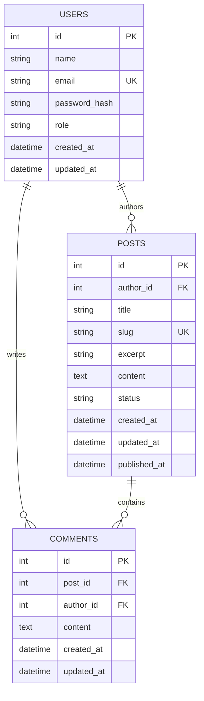

# Database Design

## Entity relationship summary

- A **User** can author zero or many **Posts**.
- A **User** can author zero or many **Comments**.
- A **Post** can contain zero or many **Comments**.
- Every post has exactly one author; every comment has exactly one author and belongs to exactly one post.

## Data dictionary

### users

| Column | Type | Constraint | Description |
|---|---|---|---|
| id | INTEGER | Primary key | Unique user identifier |
| name | TEXT | Required, 2–80 chars | Display name |
| email | TEXT | Required, unique, case-insensitive | Login identifier |
| password_hash | TEXT | Required | bcrypt hash |
| role | TEXT | `user` or `admin` | Account role |
| created_at | TEXT | Default timestamp | Creation time |
| updated_at | TEXT | Default timestamp | Last update time |

### posts

| Column | Type | Constraint | Description |
|---|---|---|---|
| id | INTEGER | Primary key | Unique post identifier |
| author_id | INTEGER | Foreign key to users | Owner |
| title | TEXT | 5–160 chars | Post title |
| slug | TEXT | Unique | URL-friendly identifier |
| excerpt | TEXT | 1–300 chars | Short summary |
| content | TEXT | 20–20,000 chars | Article body |
| status | TEXT | `draft` or `published` | Publication state |
| created_at | TEXT | Default timestamp | Creation time |
| updated_at | TEXT | Default timestamp | Last update time |
| published_at | TEXT | Nullable | Publication time |

### comments

| Column | Type | Constraint | Description |
|---|---|---|---|
| id | INTEGER | Primary key | Unique comment identifier |
| post_id | INTEGER | Foreign key to posts | Commented post |
| author_id | INTEGER | Foreign key to users | Comment author |
| content | TEXT | 2–2,000 chars | Comment body |
| created_at | TEXT | Default timestamp | Creation time |
| updated_at | TEXT | Default timestamp | Last update time |

## Indexes

- `idx_posts_author`: supports queries for an author's posts.
- `idx_posts_status_created`: supports published-post listing ordered by publication date.
- `idx_comments_post_created`: supports retrieving comments for a post in chronological order.
- `idx_comments_author`: supports author-based comment lookup.

SQLite foreign-key enforcement is enabled for every database connection.
